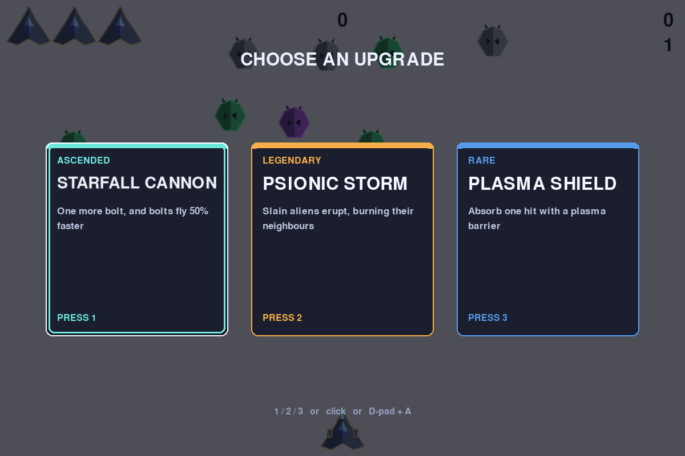
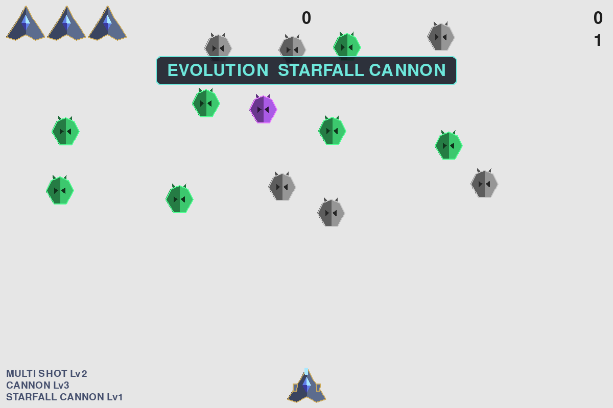

# Alien Invasion · 外星人入侵（Beta）

用 Python + pygame 写的射击游戏，教材《Python 编程：从入门到实践》第 12–14 章的项目，
在主线之上自己加了一套「局内三选一升级 + 进化树」。

**现在是最早的 beta**：请随便玩、随便找 bug。界面上的所有图形都是代码画出来的，没有素材图片。





---

## 报 bug

直接开 [Issues](../../issues/new/choose) → 选「Bug 反馈」。

一份有用的报告至少包含三件事：

1. **你按了什么**（键盘 / 手柄 / 鼠标点了哪里）
2. **你期待发生什么，实际发生了什么**
3. **终端里有没有报错**（有就整段贴上来）

能截图或录屏更好。如果是"某个升级选了没效果"，请说明你当时拿了哪几张卡
（左下角有已获升级清单）。

---

## 怎么运行

需要 **Python 3.10+**（开发环境是 3.12.10）和 **pygame 2.6**。

```bash
git clone https://github.com/yezekai-lab/skyblitz_beta.git
cd skyblitz_beta
python -m pip install -r requirements.txt
python alien_invasion.py
```

Windows 下如果 `python` 打不开，试试 `py alien_invasion.py`。

> 最高分会存在同目录的 `high_score.txt` 里（这个文件不进仓库）。

### 不用 Python 的版本

Release 里有一个 `外星人入侵.exe`（Windows 64 位），双击即玩。
首次启动约 2~4 秒（单文件要先解压），存档存在 exe 旁边。

### 自己打包 exe

```bash
python -m pip install pyinstaller
python -m PyInstaller --onefile --windowed --name "外星人入侵" alien_invasion.py
# 产物在 dist\
```

> 打包后存档路径会自动改用 exe 所在目录（`sys.frozen` 判断），
> 否则 PyInstaller 的临时解压目录一关就整个删掉，最高分每局归零。

---

## 操作

| 动作 | 键盘 | 手柄（Xbox 布局） |
|---|---|---|
| 移动 | ← → | 左摇杆（推动幅度决定速度） |
| 开火 | 空格 | A |
| 暂停 / 继续 | P | Start |
| 开始游戏 / 确认 | 回车 / 空格 | A |
| 退出（要确认） | ESC | B |
| 三选一时选卡 | 1 / 2 / 3 | 十字键左右移动 + A 确认 |
| 三选一时选卡（鼠标） | 鼠标移动高亮 + 左键点击 | — |

> 按 ESC / B 不会直接退出，会先问一句 `QUIT? Y / N`：按 **Y** 确认退出，按 **N** 或再按 ESC 取消。

手柄**不插也能玩**；中途拔掉不会崩，插上自动接管。蓝牙手柄闲置久了会自动休眠，这是正常的。

---

## 玩法

- 外星人分三种，分值 **50 / 100 / 200**，颜色不同（看颜色能估出该先打谁）。
- **难度固定**：外星人不会随着波数变强，节拍完全由升级来控制。
- 累计得分到 **400 / 1200 / 2400 / 4000 …** 会暂停并弹三张升级卡，选一张继续
  （第 n 次需要 `400 × n × (n+1) ÷ 2` 分 —— **每一次都比上一次更贵**）。
- 升级能叠级（有上限），稀有度越高越少见：COMMON → RARE → EPIC → LEGENDARY。
- **进化**：两条相关升级都拿满之后，池子里会多出一张青白色的 `ASCENDED` 卡，
  效果是两条前置的加强版。目前有三条路径：

  | 进化 | 前置（都要满级） | 效果 |
  |---|---|---|
  | STARFALL CANNON | MULTI SHOT ×2 + CANNON ×3 | 再多一发，弹速 +50% |
  | VOID LANCE | PHASE PIERCE ×1 + PSIONIC STORM ×2 | 风暴半径 +70，附赠一层护盾 |
  | CHRONO DRIVE | ENGINE ×3 + TIME WARP ×2 | 飞船 +30%，舰队 −15% |

  拿到进化时屏幕顶部会弹一条 `EVOLUTION ...` 提示。

---

## 已知限制

- **界面是英文的**：pygame 自带字体不含中文字形，`SysFont` 在 Windows 上还有已知崩溃问题。
- 只做了 **1280×800 左右**的固定窗口尺寸，没有做分辨率适配。
- 没有音效。
- 最高分是本机存档，不联网、不上传。

---

## 给开发者

代码结构和每一步的设计取舍写在 [开发说明.md](开发说明.md) 里；
无头自动化测试的原理和写法在 [测试指南.md](测试指南.md)。

```bash
python selftest.py       # 324 项断言，全部无头运行，不弹窗口
```

五套测试：核心回归 / 输入层 / 端到端主循环 / 升级池（含进化）/ 三选一界面。

### 目录

```
alien_invasion.py     主循环：事件 → 输入解释 → 更新 → 绘制
settings.py           所有可调参数
game_state.py         状态枚举（READY / PLAYING / PAUSED / UPGRADING / GAME_OVER）
input_manager.py      输入抽象层（键盘 + 手柄 → 统一的"意图"）
ship.py / bullet.py / alien.py
upgrades.py           升级池 + 进化树
upgrade_screen.py     三选一界面
scoreboard.py         HUD：分数、命数、护盾、升级清单、进化提示
art.py                低多边形美术（纯代码绘制，归一化坐标 + 假光照）
game_stats.py         分数 / 命数 / 最高分
selftest*.py          五套无头测试
probe_controller.py   开发工具：读手柄按键布局
strip_background.py   开发工具：给素材去白底（历史遗留）
```

---

## 致谢

主线玩法来自《Python 编程：从入门到实践》（第 2 版）第 12–14 章；
升级 / 进化 / 状态机 / 手柄支持是后续自己加的扩展。
