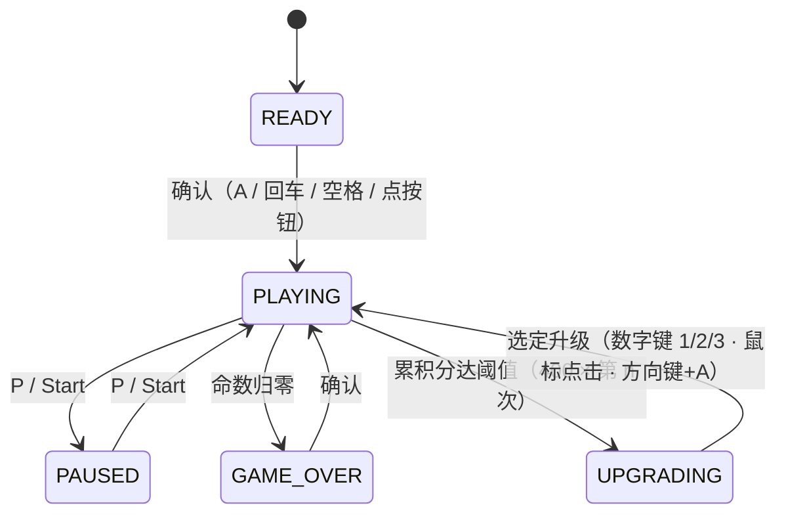

# 《外星人入侵》扩展开发说明

> 本文档说明在本项目上做的**全部改动**：做了什么、为什么这么做、遇到了什么问题、以及背后的原理。
> 面向读者：想看懂这个项目的人（包括答辩时提问的老师）。

---

## 一、项目起点与目标

**起点**：《Python编程：从入门到实践》（第 2 版）第 12—14 章的「外星人入侵」示例游戏。

**教材原版有什么**：一个固定窗口、一艘能左右移动的飞船、会发射子弹、一排排外星人整体左右移动下压、打光一批进入下一批（更快）、点击 Play 开始、有分数/等级/最高分/剩余飞船显示。

**扩展目标**：在保留教材全部功能的基础上，加入 4 项自主扩展：

| # | 扩展项 | 定位 |
|---|---|---|
| 1 | **Xbox 手柄操作** | 输入 |
| 2 | **局内 Roguelite 三选一升级** | 玩法核心 |
| 3 | **武器融合 / 进化树** | 玩法深度 |
| 4 | **不同颜色外星人分值不同** | 玩法丰富度 |

游戏画面与升级体系的美术/命名参考《弓箭手大作战》(Archero)；武器与升级命名、部分机制设计参考《星际争霸 2》的神族 (Protoss)。

---

## 二、总体架构

### 2.1 模块划分

教材原版把代码拆成 8 个文件。扩展后增加到 **15 个**，每个文件只负责一件事：

| 文件 | 职责 | 来源 |
|---|---|---|
| `alien_invasion.py` | 主类：事件 → 更新 → 绘制的主循环 | 教材 |
| `settings.py` | 所有可调参数（速度、尺寸、各项开关） | 教材 |
| `ship.py` | 飞船：移动、边界、回中 | 教材 |
| `bullet.py` | 子弹：向上飞、飞出即销毁 | 教材 |
| `alien.py` | 外星人：三种颜色的型号、边缘检测、上下浮动 | 教材 + 扩展 |
| `button.py` | Play 按钮 | 教材 |
| `game_stats.py` | 纯数据：分数 / 命数 / 等级 / 最高分 | 教材 |
| `scoreboard.py` | 屏幕文字：分数、最高分、等级、剩余飞船、护盾、已获升级清单、进化解锁提示条、PAUSED / GAME OVER | 教材 + 扩展 |
| `game_state.py` | **状态枚举**（新增） | 扩展 |
| `input_manager.py` | **输入抽象层**（新增） | 扩展 |
| `upgrades.py` | **升级池 + 进化树**（新增） | 扩展 |
| `upgrade_screen.py` | **三选一选择界面**（新增） | 扩展 |
| `art.py` | **低多边形美术生成器**（新增，纯代码画图，不读图片文件） | 扩展 |
| `probe_controller.py` | 开发工具：读手柄按键布局 | 扩展 |
| `strip_background.py` | 开发工具：给素材去白底（已被 `art.py` 取代，留作记录） | 扩展 |

### 2.2 主循环的四个阶段

```python
while True:
    self.clock.tick(self.settings.fps)     # ⓪ 限帧（见 3.5，这一行很关键）
    self.input.begin_frame()               # ① 清掉上一帧的「刚按下」标记
    self._check_events()                   # ② 处理事件，写入「意图」
    state_changed = self._handle_state_input()   # ③ 按当前状态解释意图
    if not state_changed and self.state.world_moves:
        ...更新飞船 / 子弹 / 外星人...        # ④ 只有 PLAYING 才让世界动
    self._update_screen()                  # ⑤ 绘制
```

**为什么是这个顺序**——每一步都在为下一步准备数据：

1. **⓪ 限帧**：先定住"一帧有多久"，后面的"每帧移动 N 像素"才有意义
2. **① 清边沿标记**：`fire_pressed`（刚按下）这种"一瞬间"的信号必须每帧清一次
3. **② 处理事件**：把键鼠/手柄的原始事件翻译成 `移动方向 / 确认 / 开火 / 暂停` 四种**意图**
4. **③ 解释意图**：同一个按键在不同状态下含义不同，由**状态**决定它意味着什么
5. **④ 更新世界**：只有"游戏中"状态才更新
6. **⑤ 绘制**

### 2.3 状态机



---

## 三、逐项改动说明

### 3.1 输入抽象层（支持 Xbox 手柄）

#### 做了什么

新增 `input_manager.py`，把**键盘**和**手柄**统一翻译成四种意图：

| 意图 | 含义 | 来源 |
|---|---|---|
| `read_direction()` | 移动方向，`-1.0 ~ +1.0` 的连续值 | 键盘 ←/→、左摇杆、十字键 |
| `confirm_pressed` | 「确认」 | 手柄 A、回车、空格 |
| `fire_pressed` | 「开火」（按下的那一帧） | 手柄 A、空格 |
| `pause_pressed` | 「暂停」 | 手柄 Start、P |

#### 为什么

改造前，主循环里到处是 `event.key == pygame.K_RIGHT`。如果直接在里面加手柄判断，会写成：

```python
if event.key == pygame.K_RIGHT or (pad and pad.get_axis(0) > 0.25) or ...:
```

**每加一个输入设备，所有输入点都要改一遍**，而且这些分支散落在主循环里，没法单独测试。

抽象之后，`Ship` 完全不知道手柄存在——它只知道"给我一个 -1 ~ +1 的数"。

#### 关键技术点

**① 离散输入 vs 连续输入，是两种不同的东西**

| | 键盘 | 摇杆 |
|---|---|---|
| 信号形式 | **事件**：按下 / 松开各一次 | **轮询**：每帧读当前数值 |
| 怎么知道"现在还按着没有" | **必须自己记住** | 不用记，读一次就知道 |
| 能不能表达"半速" | 不能 | 能，推多深走多快 |

所以 `InputManager` 里必须同时存在两套状态（键盘的"记忆" + 每帧读的摇杆），然后合成一个数。

→ 这解释了一件事：**为什么 `moving_right` / `moving_left` 这两个布尔量留不住了** —— 布尔量天生表达不了"中间档"。

**② 边沿触发 vs 状态保持**

| 类型 | 什么时候为真 | 要不要每帧清 | 例子 |
|---|---|---|---|
| 边沿触发 | **刚按下的那一帧** | ✅ **必须清** | `fire_pressed` |
| 状态保持 | 按着期间一直为真 | ❌ 不能清 | `fire_held` |

如果 `fire_pressed` 不清：按一下空格 → 第 1 帧开炮 → 第 2、3、4 帧**还是 True** → 一口气打光所有子弹。

**两者都要留**：单发手感靠边沿，连发（AUTO FIRE 升级）靠状态。

**③ 死区不能只是"阈值判断"，还要重新拉伸**

摇杆物理上不会精确停在 0（零点漂移），所以要设死区。但如果只写"小于 0.25 就返回 0"，会出现手感问题：推到 0.25 得到 0.25 的速度，推到底才 1.0——**刚推就窜出去，而约 1/4 的行程被浪费**。

正确做法是把 `[0.25, 1.0]` **重新映射回 `[0, 1]`**：

$$\text{速度} = \frac{|v| - 0.25}{1 - 0.25}$$

**④ 手柄按钮号：不要猜，去问 SDL**

不同手柄的按钮编号并不一样。SDL 内置一个手柄数据库，Xbox / PS / Switch 手柄插上就认得出，并给出一张官方映射表：

```python
from pygame._sdl2 import controller as sdl2
sdl2.init()
print(sdl2.Controller(0).get_mapping())
# {'a': 'b0', 'start': 'b7', 'leftx': 'a0', 'lefty': 'a1', ...}
```

本项目把它做成了工具 `probe_controller.py`：换手柄时跑一次，直接打印出可以粘回代码的常量。

**⑤ 蓝牙手柄会自己休眠**

实测：先探测到 1 个手柄，几分钟后再探测变成 0 个。**这不是 bug，是蓝牙手柄的正常行为。**

所以必须处理：

| 事件 | 要做什么 |
|---|---|
| `JOYDEVICEADDED` | 重连 |
| `JOYDEVICEREMOVED` | 放掉引用 |
| 读摇杆出错 | `try/except` → 静默降级为键盘，**绝不崩溃** |

---

### 3.2 状态管理（`game_active` → `State` 枚举）

#### 做了什么

教材用一个布尔值 `game_active` 表示"游戏是否进行中"。扩展到 5 个状态后，改成枚举：

```python
class State(Enum):
    READY, PLAYING, PAUSED, UPGRADING, GAME_OVER
```

并让**状态自己知道该怎么表现**：

| 属性 | 含义 | 为 True 的状态 |
|---|---|---|
| `world_moves` | 飞船/子弹/外星人该不该动 | 只有 `PLAYING` |
| `accepts_confirm` | 「确认」键是否表示"开始新一局" | `READY` / `GAME_OVER` |
| `shows_play_button` | 要不要显示 Play 按钮 | `READY` / `GAME_OVER` |

#### 为什么

**① 布尔量的组合是乘法增长的**

如果要表达"游戏中 / 暂停 / 正在选升级 / 已结束"，用布尔量需要 4 个变量 = **2⁴ = 16 种组合**，其中大半是无意义的（"正在选升级"同时"已结束"）。

枚举的**根本优势是互斥**：任一时刻只能处于一个状态，那些荒谬组合**从根上就不存在**。

判断也从一长串 and 变成一句话：

```python
# 以前
if game_active and not paused and not choosing and not over:
# 现在
if self.state.world_moves:
```

**② 判断逻辑搬到"数据自己身上"**

以后加一个状态，只需要回答三个问题（动不动 / 收不收确认 / 显不显示按钮），**改一处枚举，主循环一行都不用动**。

**③ 「状态」不是「数据」**

教材把 `game_active` 放在 `GameStats` 里，属于职责放错：
- `GameStats` 装的是**数据**：分数、命数、等级、最高分
- `State` 说的是**运行到哪个阶段**

两者住在一起时，改一个很容易顺手影响另一个。所以搬到了游戏主类上。

#### ⚠️ 这里踩过的坑：状态切换必须是「原子」的

改成状态机之后，"按 A 开始游戏的同一帧"会**顺带射出一发子弹**。

原因：A 键同时是「确认」和「开火」。这一帧的流程是——

1. 收到 A → `_start_game()` 让状态立刻变成 `PLAYING`
2. 紧接着判断"世界该不该动"→ 成立 → 又跑了一遍游戏更新，把 `fire_pressed` 也消费了

**同一个输入被两个状态各解释了一遍。**

**修法**：让处理输入的方法返回"这一帧状态是否变了"，状态变了就跳过本帧的游戏逻辑。

```python
state_changed = self._handle_state_input()
if not state_changed and self.state.world_moves:
    ...
```

> **规则：一次状态切换是原子的 —— 切换那一帧只重画，不跑游戏逻辑。**
>
> 这类 bug 的通式是「**同一帧里，一个事件被消费了两次**」。只要出现"某个按键在不同状态下含义不同"，就一定会遇到它。

---

### 3.3 外星人分色与分值不同

#### 做了什么

三种型号，分值不同，越强越稀有：

| 颜色 | 分值 | 权重 |
|---|---|---|
| 灰 | 50 | 60 |
| 绿 | 100 | 30 |
| 紫 | 200 | 10 |

#### 关键技术点：染色不能直接乘

原本打算用 `image.copy()` + `fill(color, special_flags=BLEND_RGB_MULT)` 给同一张图染不同颜色，**不额外下载图片**。

但实测发现 **`alien.png` 本身是绿色的**（主色 `(85,180,95)`）。而乘法染色的规则是：

$$\text{结果} = \frac{\text{原色} \times \text{染色}}{255}$$

原图的绿通道本来就高 → 乘什么颜色都压不住它：

| 想染成 | 直接乘得到 | 结果 |
|---|---|---|
| 紫 `(190,90,230)` | `(64,64,86)` | ❌ 暗蓝灰，根本不是紫 |
| 红 `(235,70,70)` | `(79,50,26)` | ❌ 棕色 |

**正解：先转灰阶（保留明暗、去掉色相），再乘目标色。**

```python
base = pygame.transform.grayscale(pygame.image.load("images/alien.png"))
base.fill(color, special_flags=pygame.BLEND_RGB_MULT)
```

| 想染成 | 先灰阶再乘 |
|---|---|
| 紫 | `(94,49,127)` ✅ |
| 红 | `(130,39,39)` ✅ |

> **原理总结：`BLEND_RGB_MULT` 的本质是「保留原图的明暗结构，替换它的色相」——
> 但这个功能只有在原图是中性色（白/灰）时才成立。**
> 所以改的不是代码，是**顺序**：先把输入规整成标准形式，再施加操作。

#### 另外两个改动

**① 分值挂在 `Alien` 实例上**（`self.points`），计分时直接读 —— 不必在计分那一刻再回头查表。

连带必须改计分逻辑：教材写的是 `alien_points * len(aliens)`（假定所有外星人同价）。现在必须**逐个外星人累加**：

```python
for hit_aliens in collisions.values():
    for alien in hit_aliens:
        self.stats.score += int(alien.points * self.settings.points_multiplier)
```

**② 图片缓存**：`image_for(color)` 对同一个颜色永远返回同一张 Surface，一队外星人共用。原来每造一个外星人都要读一次磁盘。

---

### 3.4 阵型的随机化（"不要拍成一行行"）

#### 做了什么

教材的阵型是完全对齐的方格。改了三处：

| 参数 | 含义 | 原值 → 现值 |
|---|---|---|
| `fleet_spacing` | 格子边长 = 外星人尺寸 × 这个数（决定**疏密**） | 2.0 → 2.5 |
| `fleet_jitter` | 每个外星人在自己格子里随机偏移的幅度 | 0 → 1.0 |
| `fleet_skip_chance` | 每个格子有多大几率空着 | 0 → 0.3 |

#### 核心思路：**格子当骨架，随机当装饰**

```
① 先算出格子   → 保证「排得下、不重叠」
② 每个外星人在自己格子里随机挪一点  → 保证「不刻板」
③ 随机让一些格子空着  → 保证「看起来像随机出现的」
```

**关键收益：「不重叠」是几何上保证的，不是靠调参数碰运气。**
抖动的上限是"半个空当"，所以最坏情况也只是刚好贴住邻居。

#### ⚠️ 这里踩过的两个坑

**坑 1：抖动的方向性错了**

第一版写成 `slot_base + room * (0.5 + (随机-0.5) * jitter)` —— 偏移永远是**正的**，于是整个舰队被**系统性地往右下平移**了平均 30 像素，舰队离飞船越来越近。

> **教训：随机化要看"分布的中心在哪"，不能只看"范围有多大"。**
> 偏移量如果永远是正数，那它不叫"抖动"，叫"整体平移"。

改成以原位置为中心对称抖动：

```python
return slot_base + (random.random() - 0.5) * room * jitter
```

**副产品**：`jitter = 0` 时恰好等于教材原版的整齐方格 —— 这成了一个很好的反证测试。

**坑 2：外星人像"一整块在动"，不像一个个独立的个体**

教材里所有外星人使用同一个 `alien_speed`，整体平移，视觉上就是一坨。

**修法：位置 = 基准线 + 浮动**

```python
def update(self):
    self.x += self.settings.alien_speed * self.settings.fleet_direction   # 横向：整队一起走
    self.rect.x = self.x
    self.bob_phase += self.settings.alien_bob_speed                        # 纵向：各自浮动
    self.rect.y = self.base_y + int(math.sin(self.bob_phase) * amplitude)
```

每个外星人的 `bob_phase` 随机初始化 → **不会一起动** → 看起来是"一个个怪"。

> **代价：纵向位置的真身变成了 `base_y`，`rect.y` 只是投影。**
> 所以"整队下移"必须改 `base_y`，改 `rect.y` 下一帧就被重算冲掉。
> **规律：一个数据有"真身"和"投影"时，所有修改都必须落在真身上。**

---

### 3.5 帧率限制（本项目**最重要的一个 bug**）

#### 现象

"外星人动得太快，眼花缭乱"。

#### 排查过程（没有猜，而是先测量）

```
跑了 2093 帧，用了 2.00 秒  →  每秒 1046 帧
```

#### 根因

**主循环里从来没有 `clock.tick()`。** 于是循环全力跑，帧率完全取决于电脑有多快。

而游戏里所有的速度都是"**每帧**移动 N 像素"——

| | 帧率 | 外星人速度 | 横穿屏幕 | 浮动圈数/秒 |
|---|---|---|---|---|
| **不限帧** | 1044 | 1044 px/s | **1.1 秒** | **5.0** |
| **限帧 60** | 61 | 61 px/s | 19.6 秒 | 0.3 |

**17 倍差距。**

#### 修法（两行）

```python
self.clock = pygame.time.Clock()          # __init__
...
self.clock.tick(self.settings.fps)        # 主循环第一句
```

#### 为什么这个 bug 特别值得说

> ## **所有"每帧移动 N 像素"的写法，都隐含假设"每秒固定 N 帧"。**
>
> 没有 `clock.tick()`，**书上所有的速度参数**（`ship_speed` / `bullet_speed` / `alien_speed` / `fleet_drop_speed`）**全部失去意义** —— 换一台电脑，游戏快慢就完全不同。

它**不报错、不崩溃**，只是"手感飘"，而且**依赖机器**（同一份代码在不同电脑上表现不同）。靠试玩几乎无法定位。

**方法论：手感类问题先"测量"，别"猜"。** 如果直接去调 `alien_speed`，只会掩盖真正的原因。

---

### 3.6 升级系统（参考 Archero）

#### 做了什么

新增 `upgrades.py`，实现"局内 3 选 1 升级池"。

#### Archero 的"感觉"拆解成 4 件可落地的事

| 要素 | 落地方式 |
|---|---|
| 3 选 1 | `available(3)` |
| **稀有度**（越强越少见） | `Rarity` 枚举 + 抽取权重 **COMMON 10 / RARE 5 / EPIC 2 / LEGENDARY 1** |
| 可叠级 | `max_level` |
| 组合质变 | 第 ⑤ 项武器进化树（见 3.11） |

#### 稀有度是真的影响概率（不是只改卡片颜色）

```python
pool = [u for u in self.definitions if not self.is_maxed(u)]
picked = []
while pool and len(picked) < count:
    weights = [RARITY_WEIGHT[u.rarity] for u in pool]
    chosen = random.choices(pool, weights=weights, k=1)[0]
    picked.append(chosen)
    pool.remove(chosen)      # 抽过的拿出去 → 保证不重复
```

**实测 1200 次抽样**：COMMON 743 / RARE 243 / EPIC 189 / LEGENDARY 25 —— 严格递减。

#### ⚠️ 关键认知：**权重 ≠ 频率**

实际出现频率 = **（该档条数 × 权重）÷ 全部票数**。

调整过程中出现过一次"RARE 反而比 EPIC 少见"——因为 RARE 只剩 1 条。所以**想让"越强越少见"成立，必须同时看每档有多少条**。

#### 另一条重要认知：`remove()` vs `pop()`，以及"别重造轮子"

手写"随机挑 N 个不重复"时，很容易一次踩四个坑（本项目真实踩过）：

```python
# ❌ 典型错法
for i in range(min(count, len(return_list))):    # 1. 用"结果"约束"过程"（此时还是空的）
    take = random.randint(len(available_list))   # 2. randint 要两个参数且闭区间
    return_list.append(available_list[take])
    available_list.remove(take)                  # 3. remove 按值删，按位置删要用 pop

# ✅ 等概率版本只需要一行
random.sample(candidates, min(count, len(candidates)))
```

`random.sample` **天生保证**「不重复、不超过长度」——手写循环正是在重造它。

---

### 3.7 「机制类」升级与神族元素

#### 核心区分

| | 改的是什么 | 代码上的表现 | 例子 |
|---|---|---|---|
| **数值升级** | 一个**数字** | 同一条代码路径跑得更快/更多 | `ship_speed *= 1.2` |
| **机制升级** | 一个**开关** | 代码走进**另一条分支** | `if pierce: dokill1 = False` |

> **两者在代码里是同一个动作（改一个字段），区别在于「谁去读它、读到之后怎么做」。**
> 所以做机制类升级时，**不用改升级系统的结构** —— 只要在使用它的地方留一个 `if`。

#### 当前 10 条升级

| 名字 | 稀有度 | 满级 | 类型 | 效果 |
|---|---|---|---|---|
| **PSIONIC STORM** 灵能风暴 | LEGENDARY | 2 | 神族机制 | 击落一个外星人时，炸掉它周围一圈 |
| MULTI SHOT 多重射击 | EPIC | 2 | 机制 | 一次多打一发，左右排开（1→2→3 发） |
| PHASE PIERCE 相位穿透 | EPIC | 1 | 机制 | 子弹打中后不消失，可继续打下一个 |
| AUTO FIRE 自动开火 | EPIC | 1 | 机制 | 按住开火键持续射击 |
| EXTRA LIFE 额外生命 | EPIC | 1 | 机制 | 多一条命上限，并补满 |
| **TIME WARP** 时间扭曲 | RARE | 2 | 神族机制 | 外星人整队变慢 20% |
| **PLASMA SHIELD** 等离子护盾 | RARE | 2 | 神族机制 | 撞到时先碎盾，不扣命 |
| ENGINE 引擎 | COMMON | 3 | 数值 | 飞船速度 ×1.2 |
| CANNON 炮击强化 | COMMON | 3 | 数值 | 子弹速度 ×1.25 |
| MAGAZINE 弹匣 | COMMON | 2 | 数值 | 弹药上限 +10 |

#### 神族机制的实现（都很小）

**等离子护盾**——只加了一个判断：

```python
if self.stats.shield > 0:
    self.stats.shield -= 1      # 碎盾，命数不动
else:
    self.stats.ship_left -= 1   # 才扣命
```

**灵能风暴**——8 行：

```python
radius = self.settings.psionic_radius
area = center.rect.inflate(radius * 2, radius * 2)   # 以中心为轴向四周扩大
for victim in self.aliens.sprites():                 # sprites() 返回列表副本，边删边遍历安全
    if area.colliderect(victim.rect):
        self.stats.score += int(victim.points * self.settings.points_multiplier)
        victim.kill()
```

> `rect.inflate(w, h)` 会把矩形以中心为轴扩大 —— 这是实现"爆炸范围"最省事的做法，不用算圆。

---

### 3.8 素材工具 `strip_background.py`

#### 背景

把游戏画面 `pygame.image.save()` 渲染成 PNG 后肉眼检查，发现**飞船和子弹外面包着一个白色方框**。

实测根因：`ship.png` / `bullet.png` **没有透明通道**（四角是 `(247,247,248,255)` 的浅灰白），而 `alien.png` 是好的。AI 生成素材时把图形画在了白底上。

#### 做法：**从四边做洪水填充**

⚠️ **不能用"把所有接近白色的像素变透明"这种简单写法**——因为**精灵内部也有高光**是接近白的，那样会把飞船内部挖出一堆透明的洞。

正确做法是从图片四条边出发做洪水填充，只处理**连成一片、一直连到外面**的那一片。边缘那圈抗锯齿像素给**渐变的 alpha**，避免留下白毛边。

#### 方法论

> **视觉改动不能只靠数字断言。**
> 断言能证明"数值对了"，证明不了"看起来对"。把画面渲染成 PNG 亲眼看一下，是数值测试之外必须补的一步。

---

### 3.9 低多边形美术：全部用代码画（`art.py`）

#### 为什么扔掉素材图片

前三个阶段一直走的是"找 AI 生成素材 → 去白底 → 缩放"的路线，结果连踩三个坑（第 10、11 条 bug）：没有透明通道、外框白方块、染色压不住原图的绿。

**根源在于"我不知道源图长什么样，只能事后补救"。** 换成程序化绘制后，颜色、形状、透明度全都是我写的数字 —— 出问题直接改数字，不会再出现"素材本身有问题"这种事。

#### 核心思路：**归一化坐标**

所有图形用 `0~1` 的相对坐标描述，最后乘上目标尺寸。因此同一份形状定义能画出任意大小的飞船：

```python
SHIP_HULL = [(0.50, 0.00), (0.68, 0.28), (0.62, 0.72), ...]   # 0~1 的相对坐标

def _pts(points, width, height, dx=0, dy=0, scale=1.0):
    """把归一化坐标翻译成像素坐标。"""
    cx, cy = width / 2, height / 2
    return [
        (cx + (x - 0.5) * width * scale + dx,
         cy + (y - 0.5) * height * scale + dy)
        for x, y in points
    ]
```

> **好处**：形状是"数据"而不是"像素"。想改飞船的轮廓，改一个坐标列表就行；
> 想画个 32px 的缩略版，一行 `make_ship(32, 32)`，形状自动等比缩放。

#### 假光照：把同一形状画两遍

低多边形的立体感全靠明暗切面。最省事的做法是 **把形状的左半部分用深色再画一遍**：

```python
SHIP_HULL       = [...]   # 完整轮廓
SHIP_HULL_DARK  = [...]   # 只覆盖左半边，同一组归一化坐标

# 先画亮的主体，再把左半边盖一层暗色 → 视觉上就有了"光从左上方来"
```

**几块颜色就能骗过眼睛** —— 这是低多边形风格的本质：不是靠细节，是靠切面和明暗。

#### 升级效果的视觉化（"两条腿走路"）

| 升级 | HUD 文字 | 飞船外观 |
|---|---|---|
| MULTI SHOT | `MULTI SHOT Lv2` | 船身两侧各长出一个副炮舱（`pods=2`） |
| PHASE PIERCE | `PHASE PIERCE Lv1` | 镶边从暗金变亮金（`piercing=True`） |
| PLASMA SHIELD | `PLASMA SHIELD Lv1` | 船外多一圈六边形能量环（`make_shield_ring`） |

> **只写文字玩家感觉不到"变强了"；只改外观玩家不知道"为什么变强了"。**

#### ⚠️ `_sync_look()`：别每帧重画

`make_ship()` 每次调用都要建 Surface、画十几个多边形。每帧重画一次 60 FPS 就是每秒六十次无用功。所以 `ship.py` 里记一个"上次画的时候是什么配置"：

```python
self._look_key = None

def _sync_look(self):
    key = (self.settings.bullets_per_shot, self.settings.bullets_pierce, self.stats.shield)
    if key == self._look_key:      # 配置没变 → 什么都不做
        return
    self._look_key = key
    ...重新生成图像...
```

> **这个模式叫"缓存键"**：把影响结果的**全部**输入打包成一个元组当键。少放一项 → 某个升级不生效；
> 多放一项（比如时间）→ 缓存失效。**判断标准是"输入变了输出就必须变吗"。**

#### 踩过的边界坑

`make_shield_ring()` 的半径写成 `0.42 + 0.025 * layers`，加了一层护盾就是 `0.445`，两层 `0.47`……
**半径一旦超过 `0.5`，六边形的顶点就会被 Surface 裁掉。** 所以做了硬限制：`min(layers, 3)`。

> **凡是"参数往上加会越界"的公式，都要在源头夹住**，而不是指望调用方永远不传大值。

---

### 3.10 三选一界面（`upgrade_screen.py`）

#### 做了什么

新增 `upgrade_screen.py`，一张全屏遮罩 + 三张并排的卡片，按稀有度上色。触发条件、状态切换、三种输入方式全部接通。

#### 触发条件：**门槛随次数抬高**

```python
needed = self.settings.upgrade_score_base * (self._upgrade_count + 1)
# 第 1 次升 400 分，第 2 次 800，第 3 次 1200 ……
```

如果固定 400 分一次，后期杀一个高级外星人（200 分）就直接连升 —— 升级变成"白送"，节奏崩掉。**门槛必须跟着进度涨。**

> ⚠️ 有个容易忽略的细节：`_take_upgrade()` 成功后**必须** `self._upgrade_count += 1`。
> 否则分数仍然 ≥ 阈值 → 下一帧又满足条件 → 无限弹窗。**这类"条件一旦成立就反复触发"的 bug，
> 修法永远是"改变条件本身"，而不是"加一个标志位屏蔽它"。**

#### 状态的进出：两条转换线

```python
def _begin_upgrade(self):          # PLAYING → UPGRADING
    choices = self.upgrades.available(3)
    if not choices:                # 全部满级了 → 不弹空窗
        return
    self.upgrade_screen = UpgradeScreen(choices, self.screen_rect)
    self.state = State.UPGRADING
    pygame.mouse.set_visible(True)     # 要用鼠标点，得先把光标还回来

def _take_upgrade(self):           # UPGRADING → PLAYING
    choice = self.upgrade_screen.highlighted_choice() if self.upgrade_screen else None
    if choice is None or not self.upgrades.take(choice.key):
        return                     # 守卫：拿不到合法选择就当什么都没发生
    self._upgrade_count += 1
    self.sb.prep_upgrades()        # HUD 的左下角升级列表要刷新
    self.sb.prep_shield()          # 护盾可能变了
    self.upgrade_screen = None
    self.state = State.PLAYING
    pygame.mouse.set_visible(False)    # 游戏中藏光标
```

> **成对出现的设置要放在同一个地方改。** `state` 和"光标是否可见"永远同步：
> 进 UPGRADING 就显示、回 PLAYING 就隐藏。分散在两处写 → 迟早有一个漏掉。

#### 三种输入方式，汇到同一个出口

| 方式 | 事件 | 落到哪 |
|---|---|---|
| 键盘数字 | `KEYDOWN K_1/K_2/K_3`（含小键盘） | `input.choice_pressed` |
| 手柄方向 | `JOYHATMOTION` 左右 | `input.menu_left_pressed / menu_right_pressed` |
| 手柄确认 | `JOYBUTTONDOWN b0`（A 键） | `input.confirm_pressed` |
| 鼠标 | `MOUSEBUTTONDOWN` | 直接 `_handle_mouse_click()` |

关键设计：**输入层只负责"记下发生了什么"，不负责"这意味着什么"。**

```python
# _check_events()：只翻译，不决策
if self.state is State.UPGRADING and self.upgrade_screen:
    ...
elif self.state.accepts_confirm and self.input.confirm_pressed:
    self._start_game()
```

同一个 A 键，在 READY 状态意味着"开始游戏"，在 UPGRADING 状态意味着"确认这张卡"。**如果写在事件层就分不清了**（这个坑本项目踩过两次，见 bug #3）。

#### 数字化选择的统一

数字键 `1/2/3` 被存成 **1、2、3**（不是 0、1、2），因为卡面上印的就是 "PRESS 1" —— 玩家看到的和代码里的对上，少一层心算。转换只做一次：

```python
index = self.input.choice_pressed - 1
if 0 <= index < len(self.upgrade_screen.choices):
    ...
```

> **越界检查要和取值在同一步完成。** 先判断后取值，中间不要有任何可能改变列表长度的操作。

#### 稀有度的"直观感受"

| 稀有度 | 颜色 | RGB |
|---|---|---|
| COMMON | 灰 | `(168, 176, 190)` |
| RARE | 蓝 | `(86, 156, 236)` |
| EPIC | 紫 | `(170, 108, 238)` |
| LEGENDARY | 橙金 | `(246, 174, 72)` |

`RARITY_COLOR` 放在 `upgrades.py` 里而不是界面里 —— **颜色是稀有度的属性，不是某张卡片的属性。**
卡片只用 `RARITY_COLOR[upgrade.rarity]` 去查，将来加一个新界面（比如结算页）也能直接复用。

#### 遮罩层怎么写

```python
self.backdrop = pygame.Surface(screen_size, pygame.SRCALPHA)
self.backdrop.fill((8, 10, 20, 175))     # 第 4 个值是 alpha
```

`SRCALPHA` 让 Surface 自带透明通道，`fill()` 的第四个参数就是透明度。画的时候直接整张盖上去，**背景自动变暗，不需要逐个元素调暗**。

#### 自动换行：贪心算法

`Font.render()` **不认换行符**，一段长文本会画成一整行超出卡片。只能自己拆：

```python
def _wrap_text(text, font, max_width):
    lines, current = [], ""
    for word in text.split():
        trial = f"{current} {word}".strip()
        if font.size(trial)[0] <= max_width:
            current = trial          # 还放得下 → 继续加
        else:
            lines.append(current)    # 放不下了 → 断行，从这个词重新开始
            current = word
    if current:
        lines.append(current)
    return lines
```

> 这叫**贪心换行**：每一步都尽量多塞，塞不下才断。不是最优解（可能让最后一行只剩一个词），
> 但实现简单、结果稳定，对短句完全够用。

#### 验证方式：渲染成 PNG 看

测试能证明"选中第 2 张后 `state` 变回 PLAYING"，但证明不了"三张卡片没有互相重叠"、"标题没被裁掉"。所以除了断言，还额外把界面渲染成 PNG 看了一眼（承接 3.8 的教训）。

---

### 3.11 进化（融合）树

#### 做了什么

给 `Upgrade` 加了一个字段 `requires`：**前置条件**。空元组 = 普通升级（随时可抽）；非空 = 进化，**只有前置全部满级之后才会出现在候选池里**。

```python
Upgrade(
    "starfall_cannon", "STARFALL CANNON",
    "One more bolt, and bolts fly 50% faster",
    1, _starfall_cannon, Rarity.ASCENDED, "EVOLUTION",
    requires=(("multi_shot", 2), ("cannon", 3)),   # ← 都是在说"满级"
)
```

#### 三条进化路径

| 进化 | 前置（都要满级） | 效果 |
|---|---|---|
| **STARFALL CANNON** 星裂炮 | MULTI SHOT ×2 + CANNON ×3 | 再多一发，弹速 +50% |
| **VOID LANCE** 虚空长枪 | PHASE PIERCE ×1 + PSIONIC STORM ×2 | 风暴半径 +70，送一层护盾 |
| **CHRONO DRIVE** 时空引擎 | ENGINE ×3 + TIME WARP ×2 | 飞船 +30%，舰队 −15% |

三条都遵循同一条设计原则：**进化的效果是两条前置各自效果的"加强版"，不是凭空长出一个新机制**。玩家看得懂"我为什么变强了"。

#### 为什么不是"另一套系统"

整件事只改了 `available()` 的一行筛选：

```python
pool = [
    u for u in self.definitions
    if not self.is_maxed(u) and self.is_unlocked(u)     # ← 第二个条件就是进化
]
```

`is_unlocked()` 对普通升级恒为 True（`requires` 是空元组，`all([])` 也是 True）。**这就是"给已有系统加一个字段"和"新建一套平行系统"的区别**：前者不产生第二条代码路径，也就没有"两套逻辑不一致"的机会。

#### ⚠️ 两道守门，缺一不可

| 位置 | 拦什么 | 不拦会怎样 |
|---|---|---|
| `available()` | 没解锁的进化不进候选 | 开局三张卡里就躺着进化 |
| `take()` | 没解锁的进化**取不到** | UI 不给，但测试 / 以后的作弊码一句 `take("starfall_cannon")` 就白拿 |

> **`take()` 必须自己守门，不能依赖"UI 不会给我送错的卡"。**
> 只要一个方法是公开的，就当作"随时会被绕过 UI 调用"来写。

#### 稀有度：新增 ASCENDED

`Rarity` 加了第五档 `ASCENDED`（青白 `(110,231,219)`），只给进化用。抽取权重 5 —— 和 RARE 同票，但**同时最多只有 1~3 条可抽**，所以出现频率大约是 `1×5 / (10条×平均票数)`，不会满屏进化。

#### 提示条：进化必须有反馈

效果生效在数字上（弹速、半径），玩家**看不见**。所以拿完进化后屏幕顶部会弹一条 `EVOLUTION  <名字>`，停 2.5 秒（`settings.evolution_banner_frames = 150` 帧）。

两个实现细节：

```python
# ① 只在进化那一刻渲染一次，不每帧 render()
def prep_evolution(self, title): ...

# ② 倒计时放在 _update_screen()，因为它是唯一"每帧必定被调用"的地方
if self.evolution_timer > 0:
    self.sb.show_evolution()
    self.evolution_timer -= 1
    if self.evolution_timer == 0:
        self.sb.evolution_image = None
```

> 文字画在一块深色底板上，而不是直接 blit —— 背景色是浅灰 `(230,230,230)`，青白色的字打上去几乎看不见。**卡片配色和屏幕底色是两件事，别混着设计。**

#### 验证

| 层次 | 断言 |
|---|---|
| 数据一致性 | 每条进化的前置都真实存在，且要求的等级**正好等于**那条升级的 `max_level` |
| 未解锁 | 开局抽 300 次，进化出现 0 次；直接 `take()` 返回 False |
| 边界 | MULTI SHOT 差**一级**时仍未解锁（"拿过"≠"拿满"） |
| 解锁 | 前置双满 → `available()` 里必定有它 |
| 生效 | 拿完之后快照变化；只升一级就满级；之后不再出现 |
| 跨局 | `_start_game()` 后等级归零、重新锁上 |
| 界面 | 拿进化 → 提示条出现；150 帧后自动消失；**拿普通升级不弹**（对照组） |

合计新增 23 项，`selftest_upgrades.py` 从 31 项涨到 54 项。

---

## 四、贯穿全程的方法论

### 4.1 无头自动化测试

游戏程序难测，因为默认姿势下有三件事"要人"：要显示器、要手指、要眼睛。解决办法是拆掉它们：

| 钥匙 | 做法 |
|---|---|
| **无头运行** | `os.environ["SDL_VIDEODRIVER"] = "dummy"`（必须在 `import pygame` 之前）—— 把渲染目标换成内存，代码走同一条路径 |
| **绕过人手** | 注入事件 `pygame.event.post(...)`，或直接调用 `_update_*()` |
| **把"看"换成"数字"** | 用坐标 / 数量 / 状态值代替肉眼 |

### 4.2 断言的三种类型（按稳健度）

| 类型 | 例子 | 特点 |
|---|---|---|
| **不变量** | "暂停 60 帧后所有精灵坐标不变" | 最强，调平衡时不会崩 |
| **关系** | "半推的移动量 × 2 = 全推的移动量" | 中等 |
| **具体值** | "分数 == 150" | 最脆弱，但精确算术必须用 |

**能用类型 1 就别用 2，能用 2 就别用 3。**

### 4.3 反证实验：用"故意做错"证明代码必要

- 去掉 `_check_fleet_edges()` 里的 `break` → 舰队贴墙抽搐（方向被翻转偶数次 = 没转）
- 注释掉 `bullets.empty()` → 白捡击落一个外星人
- 把 `fleet_jitter` 设为 0 → 变回整齐方格，证明这个参数真的在起作用
- 灵能风暴测"半径 = 0 时邻居应该活着" → 证明测的确实是风暴

### 4.4 单一数据源 / 单一赋值入口

一个数据有"真身"和"投影"时，所有修改都必须落在真身上：

| 真身 | 投影 | 出现过的 bug |
|---|---|---|
| `self.x`（浮点累加器） | `rect.x`（整数） | 该同步时没同步 → 飞船瞬移到左边缘 |
| `self.x` | `rect.x` | 不该同步时同步了 → 浮点精度每帧被抹掉 |
| `base_y` | `rect.y` | 改错了对象 → 加浮动后整队再也不下移 |
| `high_score`（内存） | `high_score.txt`（磁盘） | 同一个判断写两遍 → 第二个永远不成立 |

**凡是"这几个值必须一起变"的地方，就抽成一个入口**，谁也别绕过它去单独赋值：

```python
def place(self, x, y):          # 位置 + 浮点累加器 + 基准线，一次全设
    self.rect.x = x
    self.x = float(x)
    self.base_y = y
    self.rect.y = y

def center_ship(self):          # 摆位置 + 同步累加器，绑死
    self.rect.midbottom = self.screen_rect.midbottom
    self.x = float(self.rect.x)
```

### 4.5 「守门 → 干活 → 汇报」

适用于所有"用户点了一下，我要做点事"的函数：

```python
def take(self, key):
    upgrade = self.find(key)              # ① 找
    if upgrade is None:
        return False                      # ② 守门：不满足就提前返回
    if self.is_maxed(upgrade):
        return False
    self.levels[key] = self.level_of(key) + 1   # ③ 干活
    upgrade.apply(self.game)
    return True                           # ④ 汇报"做成了没有"
```

### 4.6 测试的两条自省

**① 恒真断言等于没测。** 写完一个测试要问："我把被测的东西改坏，它会红吗？"

**② 断言失败的原因，可能不是你要测的那个。**

本项目的两个真实例子：

| 测试 | 失败的真实原因 |
|---|---|
| 测"子弹穿透" | 场上只有一个外星人 → 打光它会触发「清空子弹 + 重建舰队」→ 子弹是被**清空**的，不是被**消耗**的 |
| 测"灵能风暴" | 邻居放得太近（+40 < 外星人宽 60）→ **两个外星人重叠**，那颗子弹直接打中两个，风暴开不开都会死 |

**问法：「除了我想测的原因，还有没有别的路径能让它成立 / 失败？」**

### 4.7 文件路径：`cwd` 还是 `__file__`

严格说这是 4.4「单一数据源」的一个变体：**同一个存档文件，可能有好几个"位置"，取决于你从哪启动。**

项目里的 `high_score.txt` 曾经写成 `open("high_score.txt", "w")` —— 相对**进程工作目录**。
`launch.json` 的 `cwd` 正好是 `${fileDirname}`，所以按 F5 跑一直是对的；换一种启动方式就会在别处**悄悄**新建一份。（bug #14）

| 程序产生的数据 | 路径应该锚定 | 理由 |
|---|---|---|
| 存档 / 配置 / 日志 | **脚本目录** `os.path.dirname(os.path.abspath(__file__))` | 它是程序的一部分，用户在哪启动都是同一份 |
| 用户指定的输入输出 | **cwd**（尊重命令行位置） | `python md2docx.py out.docx` 就该写到用户站的地方 |

```python
HIGH_SCORE_PATH = os.path.join(
    os.path.dirname(os.path.abspath(__file__)), "high_score.txt"
)
```

> `cwd` 是"用户站在哪"，`__file__` 是"程序住在哪"。**救命的数据别放错地方。**

**相关的项目位置约束**（2026-10-18 迁到 `D:\python`）：固定磁盘、全英文短路径、不在 OneDrive 同步目录里、不用移动硬盘（盘符会变）。

---

## 五、真实 bug 档案（时间线）

这张表本身就是"开发过程真实存在"的证据——**纯生成式的代码不会留下弯路**。

| # | 现象 | 根因 | 怎么发现的 |
|---|---|---|---|
| 1 | 点 Play 后飞船瞬移到左边缘 | `self.x = float(self.rect.x)` 写在 `center_ship()` 之前 → 记下的是 0 | 回归测试 |
| 2 | 浮点累加器像失效了，慢速移动完全不动 | `_keep_in_screen()` 无条件同步累加器，每帧抹掉小数 | 回归测试 |
| 3 | 按 A 开始游戏的同一帧顺带射出一发子弹 | 同一个输入被两个状态各解释一次 | 回归测试（**踩了两次**） |
| 4 | 外星人像一整块在动 | 所有外星人用同一个速度、没有个体差异 | 肉眼看 + 用户反馈 |
| 5 | 抖动后整队系统性往右下偏移 | 偏移量永远是正数（不是对称抖动） | 回归测试 |
| 6 | 加浮动后整队再也不下移 | 改的是 `rect.y`（投影），被 `base_y` 重算冲掉 | 回归测试 |
| 7 | **游戏快得眼花缭乱** | 主循环没有 `clock.tick()`，实测 1046 帧/秒 | **先测量再定位** |
| 8 | 玩过一局后，之后每局都是 5 条命 + 50 弹容量 | `bullets_allowed` / `ship_limit` 的初值写在 `__init__`（进程级），新局复位函数碰不到 | 写了专门的对比脚本 |
| 9 | 稀有度频率反了：RARE 比 EPIC 还少见 | 权重 ≠ 频率，要乘上"每档条数" | 回归测试 |
| 10 | 飞船和子弹外面有白方块 | 素材 PNG 没有透明通道 | **渲染成 PNG 肉眼检查** |
| 11 | 染色后所有外星人都发脏绿 | 原图本身是绿的，直接乘法染色压不住 | 染色对照实验 |
| 12 | 最高分一直是 0，文件从没被写过 | `check_high_score()` 已同步了两值，退出时再判断必然为假 | 隔离逻辑验证 |
| 13 | 界面测试 7 项失败，但游戏手动跑得好好的 | **测试代码**只调了 `_check_events()`（写意图），漏调 `_handle_state_input()`（读意图） | 先怀疑代码，再怀疑测试 —— 最后是测试的错 |
| 14 | 从项目根目录启动时最高分"丢了" | `open("high_score.txt")` 相对 cwd，文件被静默写到了另一个目录 | 迁移项目、逐条排查相对路径时发现 |
| 15 | 加进化后，「全部拿满 → 弹数 == 3」这条回归**变红** | 断言写死了具体值，而进化恰好又多给一发（3 → 4）。**代码没错，是断言太脆** | 跑全量测试 |

---

## 六、测试资产

| 文件 | 内容 | 项数 |
|---|---|---|
| `selftest.py` | **总入口**：一次跑完下面各套 | — |
| `selftest_core.py` | 核心功能回归（含状态机、分色、阵型、帧率、机制升级、神族机制、跳局泄漏） | **126** |
| `selftest_input.py` | 输入层（死区换算、键盘映射、边沿触发、手柄容错） | **52**（手柄休眠时） |
| `selftest_e2e.py` | 端到端主循环（手柄开局 → 移动 → 开火 → 暂停 → 冻结 → 恢复 → 长跑） | — |
| `selftest_upgrades.py` | 升级池（等级、满级、边界、随机性、稀有度、**进化树**） | **54** |
| `selftest_ui.py` | 三选一界面（布局不重叠、高亮循环、数字键/方向键/鼠标三条选择路径） | **21** |

**合计 253 项断言，全部无头运行，不弹窗口。** 每次改动后的固定动作：

```
python selftest.py
```

---

## 七、可调参数速查表（`settings.py`）

| 参数 | 现值 | 作用 |
|---|---|---|
| `fps` | 60 | 帧率上限（**改动前务必先看 3.5**） |
| `ship_speed` | 3.0 | 飞船速度（像素/帧） |
| `bullet_speed` | 3.0 | 子弹速度 |
| `alien_speed` | 1.0 | 外星人横向速度 |
| `fleet_drop_speed` | 10 | 每次撞边下移多少像素 |
| `fleet_spacing` | 2.5 | 格子边长 = 外星人尺寸 × 此值（**疏密**） |
| `fleet_jitter` | 1.0 | 阵型抖动幅度（0 = 整齐方格） |
| `fleet_skip_chance` | 0.3 | 每个格子空着的概率 |
| `alien_bob_amplitude` | 9 | 外星人上下浮动幅度（0 = 关掉） |
| `alien_bob_speed` | 0.03 | 浮动快慢 |
| `bullets_allowed` | 20 | 屏幕上同时存在的子弹上限 |
| `ship_limit` | 3 | 初始命数 |
| `speedup_scale` | 1.1 | 每过一批怪物的难度增幅 |
| `score_scale` | 1.5 | 每过一批怪物的分值增幅 |
| `upgrade_score_base` | 400 | 第 n 次升级需 `base × n` 分（见 3.10） |
| `evolution_banner_frames` | 150 | 进化提示条显示多少帧（150 ÷ 60 ≈ 2.5 秒） |

> ⚠️ **凡是会被升级改动的项，初始值都写在 `initialize_dynamic_settings()` 里**（而不是 `__init__`），
> 否则会出现"跨局累积"。

---

## 八、后续计划

| 项 | 状态 |
|---|---|
| ① Xbox 手柄操作 | ✅ 完成 |
| ② 状态管理 | ✅ 完成 |
| ③ 外星人分色与分值 | ✅ 完成 |
| ④ 三选一升级：升级池 + 10 条升级 | ✅ 完成 |
| ④ 三选一升级：卡片界面（按稀有度上色） | ✅ 完成（三种输入方式均可） |
| ④ 升级系统自动化测试 | ✅ 完成（`selftest_upgrades.py` + `selftest_ui.py`） |
| ⑤ 武器融合 / 进化树 | ✅ 完成（3 条进化路径 + 屏幕提示） |
| 美术优化·第二轮（卡片动效、受伤闪红、背景） | ⏳ 待做 |
| 演示稿 + 复盘 | ⏳ 待做 |

---

## 附：本文档引用的两份活文档

| 文件 | 内容 |
|---|---|
| `../进度日志.md` | 逐日开发记录（含每日决策与验证结果） |
| `../踩坑记录.md` | 按主题整理的"现象 → 原因 → 解决" |
| `测试指南.md` | 无头测试的原理与写法（含可照抄的模板） |
